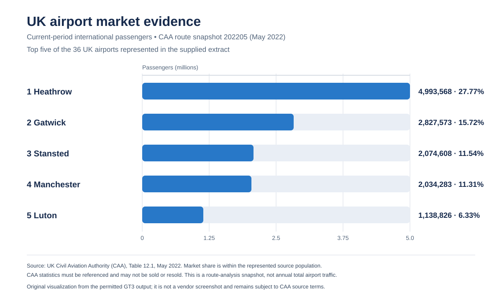
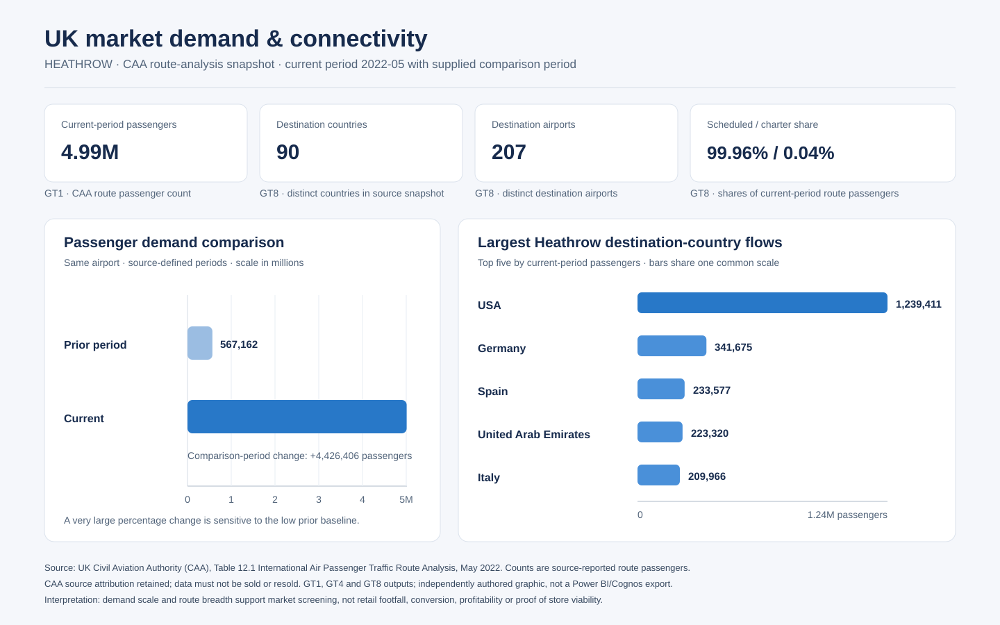
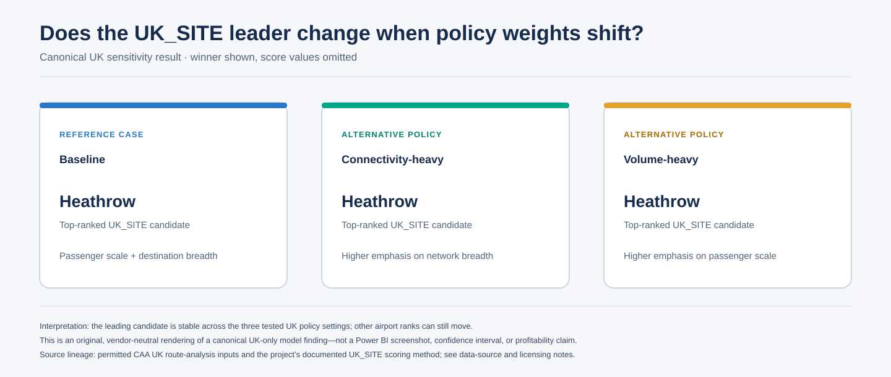
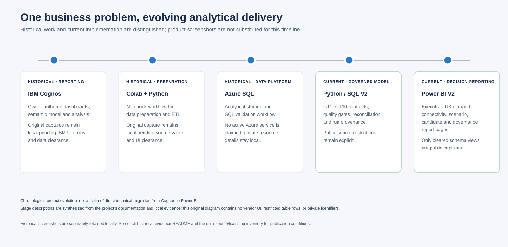
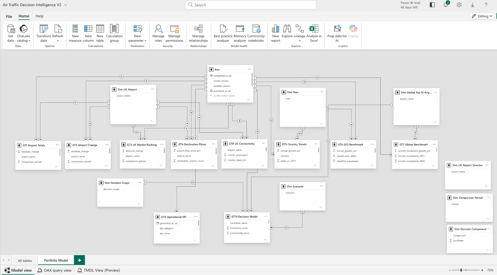
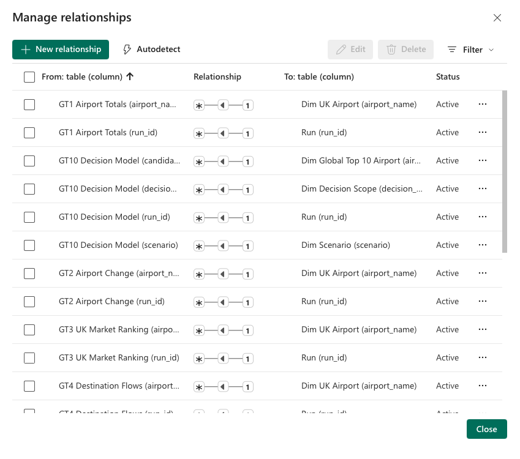

# AirTrafficAnalytics

[](https://github.com/vlad12-k/air-traffic-analytics/actions/workflows/ci.yml)

**Evidence-driven airport expansion decision intelligence for a boutique retail business.** The project evaluates UK airport markets for a first boutique and separately frames international airports for possible later expansion. It is decision support—not a live airport service, sales forecast, commercial feasibility study, or investment recommendation.

## Executive overview

The business problem was to replace an informal “which airport looks promising?” discussion with an auditable comparison of passenger scale, market position, destination connectivity and scenario assumptions. The model separates the initial **UK_SITE** decision from the later **GLOBAL_EXPANSION** screen because their candidate populations and source data differ. Per the project owner, the IBM Cognos and Power BI dashboard/report designs and analysis were personally created for the academic work; IBM and Microsoft supplied the tools, not the analytical authorship. The college supplied dataset links and learning resources, which document access but do not grant redistribution rights.

The complete local project and canonical run remain preserved. This public repository is a rights-filtered subset: it includes permitted UK/SFO outputs and non-data provenance evidence, but omits raw input files, AVI0301-derived global results, detailed QA rows and uncleared vendor-UI captures.

## Business questions

1. **UK_SITE:** Which UK airport market is strongest for further investigation as the first boutique location?
2. **GLOBAL_EXPANSION:** Which non-UK airport markets merit consideration after the first-site decision?

The intended decision owner is inferred to be the boutique owner or expansion leadership; analytics/BI users maintain the governed measures and reporting. The repository contains no formal stakeholder matrix or separate original academic report.

## Verified findings

The canonical UK analysis uses the CAA May 2022 route snapshot and its supplied comparison period. In the 36-airport population represented by the extract, Heathrow leads current passenger scale at **4.99 million** (**27.77%** of that represented total), with 90 destination countries and 207 destination airports recorded in GT8. The canonical UK_SITE baseline ranks Heathrow first and keeps it at the top across the three tested UK policy scenarios. These are reasons to prioritize further due diligence—not proof that a shop will be profitable.



The CAA source requires attribution and prohibits resale; those conditions are recorded in the [data-source and licensing inventory](docs/data-sources-and-licensing.md). The SVG is an independently authored chart from permitted GT3 output, not a Power BI or Cognos screenshot.



*An original, vendor-neutral view of Heathrow's CAA route passenger comparison and top destination-country flows. It addresses whether market scale is accompanied by route breadth; it is not retail footfall or a Power BI export. CAA attribution and no-resale conditions are embedded in the figure.*

AVI0105 adds country-level demand context: “Spain & Canary Islands” is the largest reported 2023 grouping, followed by the United States. This is not an airport-level recovery measure. The historical SFO series shows a large 2019–2020 disruption, but it is context only and ends in 2020.



*Original rendering of the canonical UK-only sensitivity result. It shows the leading candidate, not scenario scores; the analysis tests policy-weight sensitivity, not probability or profitability.*

**Global expansion findings are not published.** AVI0301 is ICAO-sourced and its redistribution rights are unresolved; no global candidate names, scores, ranks or recommendations are reproduced here.

## Project evolution

- **Historical IBM Cognos Analytics:** per the owner, the executive, demand, filter, operational and risk dashboard/report content and analysis were personally created in the IBM Cognos platform. IBM supplied the software interface; interface screenshot rights are separate. Captures remain local because reuse terms are not documented and some display source-restricted values.
- **Historical Colab / Python / Azure SQL:** archived evidence shows the project's notebook-based ETL/upload workflow and SQL validation. Google Colab and Azure were the tools; their UI captures and data-bearing results require separate rights review. No Azure service is claimed to be active.
- **Current Python/SQL V2 analytical model:** modular ingestion, cleaning, GT1–GT10 contracts, source reconciliation, quality gates, model versioning and run provenance.
- **Power BI V2:** later report pages cover the executive decision, UK demand, destination/connectivity, global expansion, scenarios, candidate detail, governance and model relationships. Only the two unchanged, schema-only Microsoft Power BI model/relationship screenshots are included; data-bearing report captures are excluded.

The project shows sequential implementations of a similar business workflow; it does not claim a direct technical migration from Cognos to Power BI. For the detailed timeline and methods, see the [business case study](docs/business-case-study.md).



*Original project timeline synthesized from project documentation and historical evidence—not a vendor screenshot. It separates historical tools from the current governed model and report layer.*

## BI dashboard and model gallery

The two included schema-only screenshots contain no third-party data rows or identifiable person. **Used with permission from Microsoft.**

| Semantic model | Relationships |
|---|---|
|  |  |

The nine other Power BI page captures remain local-only or not cleared under the source and screenshot conditions documented in the [public and local-only evidence index](docs/evidence/README.md) and [Power BI evidence notes](docs/evidence/power-bi-v2/README.md). Microsoft's screenshot conditions are summarized in the [licensing inventory](docs/data-sources-and-licensing.md).

## Architecture and methodology

```text
Aviation source extracts
        ↓
Python ingestion, cleaning and standardisation
        ↓
Governed GT1–GT8 + GT10 decision model
        ↓
Quality checks, reconciliation, GT9, provenance
        ↓
SQL publication design (meta / bi / reporting)
        ↓
Power BI V2 report layer
```

GT1–GT8 capture UK market, comparison, destination, trend, benchmark and connectivity measures; GT9 records operational/data-quality KPIs; GT10 stores recommendations at candidate × decision scope × scenario × model version. UK_SITE and GLOBAL_EXPANSION are normalized and ranked independently. Scenarios vary explicit policy weights; their stability is sensitivity to assumptions, not statistical confidence. Detailed contracts and weights are in [`docs/gt-contracts.md`](docs/gt-contracts.md) and [`docs/decision-model.md`](docs/decision-model.md).

## Data governance and validation

The canonical local run `20261005T163644Z_33f9f4ffa323` is recorded as `VALIDATED_LOCAL`. Its QA record reports 30 checks, zero failures and zero warnings. Source/artifact manifests in the public candidate contain paths, sizes and hashes only; sample rows, row-level QA, candidate-level files and Azure result logs are local-only. The manifest entries were checked against the preserved local run by size and SHA-256.

Azure SQL schema, reporting-view and validation scripts are included, but no live Azure operation was performed for this case study. The archived run and screenshot evidence are not claims of a currently deployed or refreshing Azure, Power BI, Cognos or watsonx service.

## Continuous integration

The GitHub Actions workflow is configured for Python 3.11 on pushes to `main`, pull requests targeting `main`, and manual dispatch. It installs the locked environment with `uv sync --locked --extra dev`, compiles `src/`, `scripts/` and `tests/`, and runs the self-contained test subset. The public CI job will report source-dependent tests as not executed, not passed. No test contacts Azure or another external service; Azure configuration tests only build a connection-string value.

The repository's suite currently collects **37** tests: **3** are self-contained and run in public CI; **34** are marked `requires_sources` because they call the canonical ingestion/analytics path and need local CSV inputs. These are in `test_clean.py` (the source-backed cases), `test_ingest.py`, `test_gt4_null_semantics.py`, `test_golden_tables.py`, `test_quality.py`, `test_scoring.py`, `test_pipeline.py` and `test_numeric_finiteness.py`. The synthetic AVI0301-cleaning unit test remains self-contained; it uses example values, not aviation rows.

For a clean checkout, install from the lock and run the same public-safe checks:

```bash
uv sync --locked --extra dev
uv run python -m compileall -q src scripts tests
uv run pytest -q -m "not requires_sources"
```

With all four source files named in `src/airtraffic/config.py` lawfully available under `data/raw/`, run the complete local suite with `uv run pytest -q`. They are not bundled in the public repository; AVI0301/ICAO rights remain unresolved, so clean-clone reproduction of the full pipeline is intentionally unavailable. No CI status badge is shown until the workflow has completed successfully on GitHub.

## Reproducibility, licensing and limitations

The Python package requires four CSV inputs under `data/raw/`; none are bundled. Full pipeline/tests therefore require lawfully obtained local source files. AVI0301/ICAO rights are unresolved, so a clean clone cannot reproduce the global benchmark or complete run until those rights and a lawful input path are settled. The local test suite passed **37 tests** with the local source environment; coverage is not configured.

CAA Table 12.1 must be attributed and may not be resold; DfT AVI0105 carries OGL/source-note conditions; DataSF identifies the SFO dataset as PDDL 1.0. The MIT `LICENSE` covers original code only—not datasets, derived third-party statistics, screenshots or other publisher materials. See [`docs/data-sources-and-licensing.md`](docs/data-sources-and-licensing.md) and [`docs/reproducibility.md`](docs/reproducibility.md).

Other limitations: sources are historical snapshots; CAA route data is one comparison snapshot, not a multi-year airport history; AVI0105 is country-level; SFO is an external historical comparator ending in 2020; the global benchmark is limited to AVI0301's source population; and the model omits commercial inputs such as rent, retail conversion, available premises and operating margin. Rankings are comparative screens, not forecasts or proof of viability.

## Documentation

- [Business case study](docs/business-case-study.md)
- [Architecture](docs/architecture.md)
- [Analytical lineage](docs/lineage.md)
- [GT1–GT10 contracts](docs/gt-contracts.md)
- [Decision model](docs/decision-model.md)
- [Data sources and licensing](docs/data-sources-and-licensing.md)
- [Evidence and local-only screenshot indexes](docs/evidence/)
