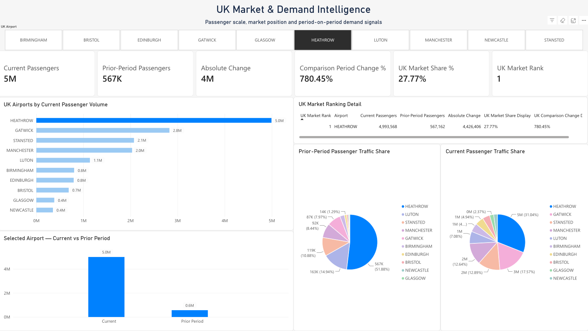
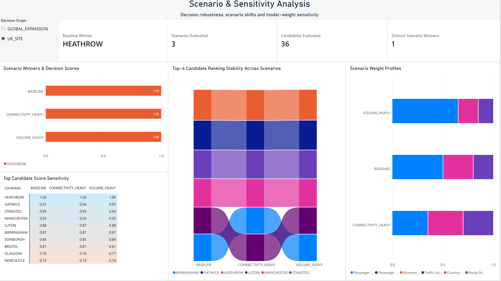
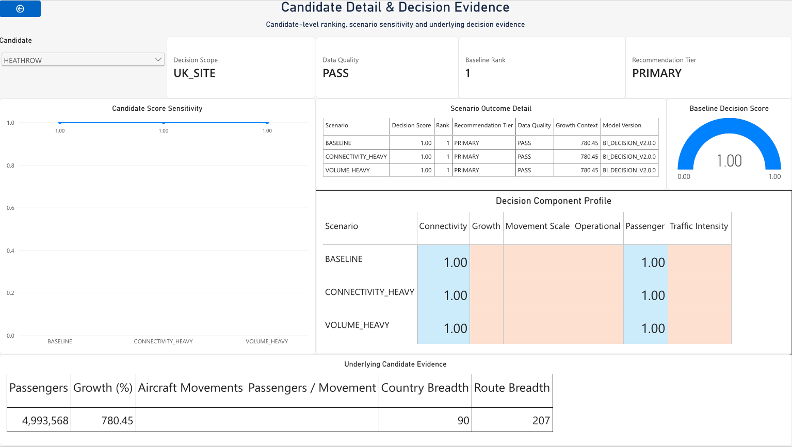
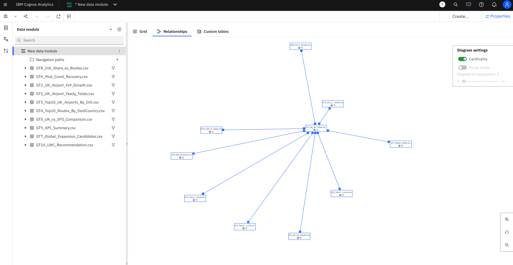
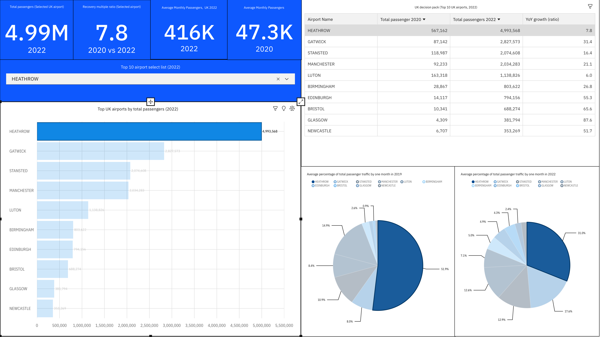

# AirTrafficAnalytics

[](https://github.com/vlad12-k/air-traffic-analytics/actions/workflows/ci.yml)

**Evidence-driven airport expansion decision intelligence for a boutique retail business.** The project evaluates UK airport markets for a first boutique and separately frames international airports for possible later expansion. It is decision support—not a live airport service, sales forecast, commercial feasibility study, or investment recommendation.

## Executive overview

The business problem was to replace an informal “which airport looks promising?” discussion with an auditable comparison of passenger scale, market position, destination connectivity and scenario assumptions. The model separates the initial **UK_SITE** decision from the later **GLOBAL_EXPANSION** screen because their candidate populations and source data differ. Per the project owner, the IBM Cognos and Power BI dashboard/report designs and analysis were personally created for the academic work; IBM and Microsoft supplied the tools, not the analytical authorship. The college supplied dataset links and learning resources, which document access but do not grant redistribution rights.

The complete local project and canonical run remain preserved. This public repository is a rights-filtered subset: it omits raw inputs, AVI0301/ICAO-derived global results and detailed QA outputs. It includes five original captures of the project owner's BI work at the owner's direction; captions preserve CAA conditions and explicitly do not claim Microsoft/IBM permission or endorsement. Other uncleared screenshots remain local.

## Authentic BI platform screenshots

The project owner states they created the Power BI and Cognos reports and analysis. The original PNGs below come from the supplied archive; they are not reconstructed or redacted. The owner's authorization to show their authored report work does not assert vendor permission or endorsement.

### Microsoft Power BI V2

#### UK airport demand



*User-created demand report supporting the UK_SITE market-screening question. Source: UK CAA Table 12.1, May 2022. CAA requires source reference and prohibits resale; the screenshot also displays Power BI UI. No Microsoft endorsement or separate Microsoft permission is claimed for this data-bearing capture.*

#### UK_SITE scenario sensitivity



*User-created scenario analysis comparing UK_SITE ranking under the baseline, volume-heavy and connectivity-heavy policies. Source: UK CAA Table 12.1, May 2022; CAA source reference and no-resale conditions apply. This is a genuine Power BI capture, not the supplemental SVG result summary; no Microsoft permission or endorsement is claimed.*

#### Heathrow candidate detail



*User-created candidate-detail report explaining the Heathrow UK_SITE screen using CAA-derived measures. Source: UK CAA Table 12.1, May 2022; CAA source reference and no-resale conditions apply. The screenshot contains Power BI UI; no Microsoft permission or endorsement is claimed.*

#### Semantic model and relationships

The two previously published, unchanged schema screenshots show the author's model design rather than airport data rows.

| Semantic model | Relationships |
|---|---|
|  |  |

**Attribution on these two schema-only captures:** “Used with permission from Microsoft.” This is the standard published screenshot attribution for those data-free images; it is not an endorsement or a bespoke permission letter. The three CAA-based report pages above are included at the project owner's direction with the vendor-UI risk explicitly disclosed; the six remaining report pages are not included, as detailed in the [evidence index](docs/evidence/README.md).

### IBM Cognos Analytics — historical work

#### Semantic model



*The owner-created semantic-model view demonstrates historical Cognos model design. The original Cognos interface is visible; no IBM permission or endorsement is claimed.*

#### UK demand filter



*The owner-created report uses a UK airport filter to examine passenger demand. Source: UK CAA Table 12.1, May 2022; CAA attribution/no-resale conditions apply. IBM Cognos UI is visible; no IBM permission or endorsement is claimed.*

The two Cognos screenshots above are included at the project owner's direction; they reproduce IBM Cognos UI and do not claim IBM permission or endorsement. Six other Cognos captures remain local. The recovery page `10-cognos-demand-recovery.png` is excluded because its global airport/city comparison has no source lineage visible on the capture. The executive/global captures remain excluded under the existing AVI0301/ICAO restriction; operational/risk pages also remain local pending source and UI review. See the [evidence index](docs/evidence/README.md) for exact files and conditions.

## Business questions

1. **UK_SITE:** Which UK airport market is strongest for further investigation as the first boutique location?
2. **GLOBAL_EXPANSION:** Which non-UK airport markets merit consideration after the first-site decision?

The intended decision owner is inferred to be the boutique owner or expansion leadership; analytics/BI users maintain the governed measures and reporting. The repository contains no formal stakeholder matrix or separate original academic report.

## Verified findings

The canonical UK analysis uses the CAA May 2022 route snapshot and its supplied comparison period. In the 36-airport population represented by the extract, Heathrow leads current passenger scale at **4.99 million** (**27.77%** of that represented total), with 90 destination countries and 207 destination airports recorded in GT8. The canonical UK_SITE baseline ranks Heathrow first and keeps it at the top across the three tested UK policy scenarios. These are reasons to prioritize further due diligence—not proof that a shop will be profitable.


The CAA source requires attribution and prohibits resale; those conditions are recorded in the [data-source and licensing inventory](docs/data-sources-and-licensing.md). The SVG is an independently authored chart from permitted GT3 output, not a Power BI or Cognos screenshot.


*An original, vendor-neutral view of Heathrow's CAA route passenger comparison and top destination-country flows. It addresses whether market scale is accompanied by route breadth; it is not retail footfall or a Power BI export. CAA attribution and no-resale conditions are embedded in the figure.*

AVI0105 adds country-level demand context: “Spain & Canary Islands” is the largest reported 2023 grouping, followed by the United States. This is not an airport-level recovery measure. The historical SFO series shows a large 2019–2020 disruption, but it is context only and ends in 2020.


*Original rendering of the canonical UK-only sensitivity result. It shows the leading candidate, not scenario scores; the analysis tests policy-weight sensitivity, not probability or profitability.*

**Global expansion findings are not published.** AVI0301 is ICAO-sourced and its redistribution rights are unresolved; no global candidate names, scores, ranks or recommendations are reproduced here.

## Project evolution

- **Historical IBM Cognos Analytics:** the project owner personally created the semantic model and reports. Original captures of the model and UK demand filter are included at the owner's direction with no IBM permission or endorsement claimed; the recovery page has unresolved global data lineage, and the executive/operational/risk captures remain local under existing data restrictions.
- **Historical Colab / Python / Azure SQL:** archived evidence shows the project's notebook-based ETL/upload workflow and SQL validation. Google Colab and Azure were the tools; their UI captures and data-bearing results remain local due to source, privacy or UI-rights issues. No Azure service is claimed to be active.
- **Current Python/SQL V2 analytical model:** modular ingestion, cleaning, GT1–GT10 contracts, source reconciliation, quality gates, model versioning and run provenance.
- **Power BI V2:** the owner's report pages cover executive decision, UK demand, connectivity, scenarios, candidate detail, governance and model relationships. Three original CAA-based report captures and the two previously published schema screenshots are shown; no Microsoft permission or endorsement is claimed for the three data-bearing captures. Remaining global and other report captures stay local.

The project shows sequential implementations of a similar business workflow; it does not claim a direct technical migration from Cognos to Power BI. For the detailed timeline and methods, see the [business case study](docs/business-case-study.md).


*Supplementary diagram summarized from project documents; it is not a software screenshot, report export, or proof of use of IBM Cognos, Google Colab, Azure SQL, Python/SQL V2, or Power BI.*

## Architecture and methodology

```text
Aviation source extracts
        ↓
Python ingestion, cleaning and standardisation
        ↓
Governed GT1–GT8 + GT10 decision model
        ↓
Quality checks, reconciliation, GT9, provenance
        ↓
SQL publication design (meta / bi / reporting)
        ↓
Power BI V2 report layer
```

GT1–GT8 capture UK market, comparison, destination, trend, benchmark and connectivity measures; GT9 records operational/data-quality KPIs; GT10 stores recommendations at candidate × decision scope × scenario × model version. UK_SITE and GLOBAL_EXPANSION are normalized and ranked independently. Scenarios vary explicit policy weights; their stability is sensitivity to assumptions, not statistical confidence. Detailed contracts and weights are in [`docs/gt-contracts.md`](docs/gt-contracts.md) and [`docs/decision-model.md`](docs/decision-model.md).

## Data governance and validation

The canonical local run `20261005T163644Z_33f9f4ffa323` is recorded as `VALIDATED_LOCAL`. Its QA record reports 30 checks, zero failures and zero warnings. Source/artifact manifests in the public candidate contain paths, sizes and hashes only; sample rows, row-level QA, candidate-level files and Azure result logs are local-only. The manifest entries were checked against the preserved local run by size and SHA-256.

Azure SQL schema, reporting-view and validation scripts are included, but no live Azure operation was performed for this case study. The archived run and screenshot evidence are not claims of a currently deployed or refreshing Azure, Power BI, Cognos or watsonx service.

## Continuous integration

The GitHub Actions workflow is configured for Python 3.11 on pushes to `main`, pull requests targeting `main`, and manual dispatch. It installs the locked environment with `uv sync --locked --extra dev`, compiles `src/`, `scripts/` and `tests/`, and runs the self-contained test subset. The public CI job will report source-dependent tests as not executed, not passed. No test contacts Azure or another external service; Azure configuration tests only build a connection-string value.

The repository's suite currently collects **45** tests: **11** are self-contained and run in public CI; **34** are marked `requires_sources` because they call the canonical ingestion/analytics path and need local CSV inputs. The public subset consists of pure configuration/ODBC normalization tests in `test_azure_config.py` and the synthetic AVI0301-cleaning unit test in `test_clean.py`; its AVI0301 example values are artificial, not aviation rows. The source-dependent cases are in `test_clean.py`, `test_ingest.py`, `test_gt4_null_semantics.py`, `test_golden_tables.py`, `test_quality.py`, `test_scoring.py`, `test_pipeline.py` and `test_numeric_finiteness.py`.

For a clean checkout, install from the lock and run the same public-safe checks:

```bash
uv sync --locked --extra dev
uv run python -m compileall -q src scripts tests
uv run pytest -q -m "not requires_sources"
```

With all four source files named in `src/airtraffic/config.py` lawfully available under `data/raw/`, run the complete local suite with `uv run pytest -q`. They are not bundled in the public repository; AVI0301/ICAO rights remain unresolved, so clean-clone reproduction of the full pipeline is intentionally unavailable. No CI status badge is shown until the workflow has completed successfully on GitHub.

## Reproducibility, licensing and limitations

The Python package requires four CSV inputs under `data/raw/`; none are bundled. Full pipeline/tests therefore require lawfully obtained local source files. AVI0301/ICAO rights are unresolved, so a clean clone cannot reproduce the global benchmark or complete run until those rights and a lawful input path are settled. The local test suite passed **45 tests** with the local source environment; coverage is not configured.

CAA Table 12.1 must be attributed and may not be resold; DfT AVI0105 carries OGL/source-note conditions; DataSF identifies the SFO dataset as PDDL 1.0. The MIT `LICENSE` covers original code only—not datasets, derived third-party statistics, screenshots or other publisher materials. See [`docs/data-sources-and-licensing.md`](docs/data-sources-and-licensing.md) and [`docs/reproducibility.md`](docs/reproducibility.md).

Other limitations: sources are historical snapshots; CAA route data is one comparison snapshot, not a multi-year airport history; AVI0105 is country-level; SFO is an external historical comparator ending in 2020; the global benchmark is limited to AVI0301's source population; and the model omits commercial inputs such as rent, retail conversion, available premises and operating margin. Rankings are comparative screens, not forecasts or proof of viability.

## Documentation

- [Business case study](docs/business-case-study.md)
- [Architecture](docs/architecture.md)
- [Analytical lineage](docs/lineage.md)
- [GT1–GT10 contracts](docs/gt-contracts.md)
- [Decision model](docs/decision-model.md)
- [Data sources and licensing](docs/data-sources-and-licensing.md)
- [Evidence and local-only screenshot indexes](docs/evidence/)
