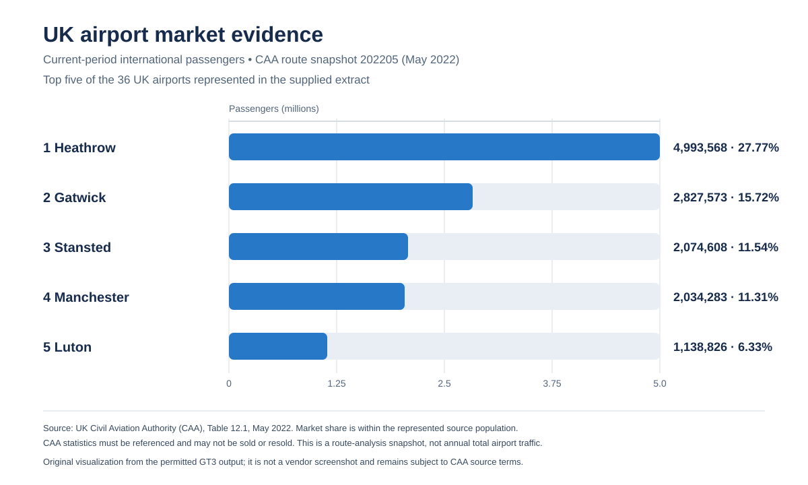

# AirTrafficAnalytics — Business Case Study

> **Decision-support case study:** an individual academic and portfolio project, not a commercial deployment, retail forecast or investment recommendation. The archived canonical local run is `20261005T163644Z_33f9f4ffa323` (`VALIDATED_LOCAL`); it was not regenerated for this write-up.

This project began as a **Unit 19 Business Intelligence academic assessment**. The assignment framed the decision as a fictional scenario involving RCO Data Services Ltd (RDS) and Luxury Watch Company (LWC); neither is an actual employer, customer, or commercial client. See [academic provenance](academic-provenance.md) for the distinction between the assignment periods, later V2 snapshots, and third-party reuse rights. The full assignment brief is not reproduced here.

## 1. Business challenge

A boutique retailer considering airport-based expansion needs to decide which markets deserve scarce site-research effort. Passenger totals are a useful starting point, but do not measure the people who pass a particular retail unit, the availability or cost of premises, the store's conversion rate, or whether the unit economics work. A large airport can therefore be a strong market to investigate without being a viable store location.

The project frames two distinct questions:

- **UK_SITE:** Which airport in the represented UK population should be investigated first for a first boutique?
- **GLOBAL_EXPANSION:** Which non-UK airports could be screened for possible later expansion?

These are separate decisions, candidate populations and data lineages. A ranking is an explainable screening aid, not a forecast of sales or a recommendation to sign a lease.

## 2. Requirements and decision boundaries

The repository supports these analytical requirements: compare observed passenger scale; describe destination connectivity and traffic mix; keep reporting periods and denominators visible; make candidate eligibility and scoring assumptions inspectable; test alternative policy priorities; and preserve data lineage, quality results and run provenance.

The project contains no formal stakeholder matrix, signed requirements document or original academic report deck. A boutique owner or expansion lead is an inferred decision owner—not a recorded stakeholder. Requirements above are derived from the project’s documented decision scopes, not attributed to an invented client or commercial engagement.

## 3. Data and provenance

The project owner reports that the college provided source links and learning resources. That records the project’s access history; it does not itself grant redistribution rights. Inputs are obtained locally and are not bundled in the repository.

| Source | Role in the analysis | Period and boundary |
|---|---|---|
| UK CAA Table 12.1 (`ROUTES`) | UK airport passenger comparisons, airport-to-country flows and connectivity | May 2022 route-analysis extract, source period `202205`, compared with May 2021. CAA requires attribution/reference and says the statistics may not be sold on to a third party.[4][12] |
| DfT AVI0105 | Country-level UK international passenger context | 2013–2023; national/country series, not airport-level recovery. DfT source/table conditions apply. |
| DfT AVI0301 (ICAO-sourced) | Global airport benchmark for the model design | 2021–2022 local snapshot. Exact ICAO-originating edition/terms are not recorded; raw rows and GT7/GT9/GT10 CSVs are not tracked in the golden outputs. Some existing public screenshots display AVI0301-associated values; the screenshot inventory records the unresolved boundary. |
| SFO Air Traffic Passenger Statistics (DataSF) | Separate historical disruption context | Local source snapshot covers activity periods 2005-01 through 2025-07; the filename ends in 2005-2020. This is geographically distinct and not a direct UK-airport proxy.[5][14] |

The metadata manifests record input paths, sizes and hashes only. No raw source CSV or row-level canonical run output is included. See the [source and licensing inventory](data-sources-and-licensing.md) for source-specific attribution and reuse boundaries.

## 4. Analytical method

The Python/SQL V2 implementation reads local sources, applies source-specific cleaning, produces governed analytical tables, reconciles outputs, evaluates quality checks, and records run provenance. SQL defines run-aware `meta`, `bi` and `reporting` structures; it is a deployment design, not evidence of a currently operating Azure SQL service. Power BI V2 is the later reporting layer.

The GT1–GT10 contracts separate distinct analytical responsibilities:

| Contract | Purpose |
|---|---|
| GT1–GT3 | UK current/prior passenger totals, period change and ranking across the full represented population |
| GT4, GT8 | UK airport-to-destination-country flows, destination breadth and scheduled/charter context |
| GT5–GT6 | Country-level DfT trends and a separate historical SFO benchmark |
| GT7 | Global airport benchmark; AVI0301-derived output is excluded from the public data tables |
| GT9 | Per-run operational, coverage and data-quality measures |
| GT10 | Candidate decisions at `candidate × decision_scope × scenario × model_version` grain |

The implemented code is inspectable in [`ingest.py`](../src/airtraffic/ingest.py), [`clean.py`](../src/airtraffic/clean.py), [`golden.py`](../src/airtraffic/golden.py), [`scoring.py`](../src/airtraffic/scoring.py), [`quality.py`](../src/airtraffic/quality.py), [`pipeline.py`](../src/airtraffic/pipeline.py), [`provenance.py`](../src/airtraffic/provenance.py) and [`export.py`](../src/airtraffic/export.py). The deeper [engineering walkthrough](end-to-end-project-walkthrough.md) links these modules to SQL, tests and evidence.

## 5. Decision model and scenarios

For **UK_SITE**, the candidate population is the airports represented in the CAA route-analysis layer. Component scores use within-population percentiles for passenger scale, destination-country breadth and destination-airport breadth. The composite score is a transparent weighted sum; the weights are policy choices, not fitted probabilities.

| UK_SITE scenario | Passenger scale | Country breadth | Airport breadth |
|---|---:|---:|---:|
| BASELINE | 0.50 | 0.30 | 0.20 |
| VOLUME_HEAVY | 0.65 | 0.20 | 0.15 |
| CONNECTIVITY_HEAVY | 0.35 | 0.35 | 0.30 |

Growth remains context rather than a dominant UK scoring component because a zero or small prior-period denominator can create an extreme percentage. Scheduled/charter mix is reported as context, not treated as a proxy for retail demand.

**GLOBAL_EXPANSION** uses a separate AVI0301/GT7 population and separate within-scope normalisation. A deterministic cross-source eligibility check excludes airports already represented in UK_SITE. Its documented components are passenger scale, passenger growth, movement scale and passengers per movement; the last is an operational intensity measure, not profitability.

| GLOBAL_EXPANSION scenario | Passenger scale | Passenger growth | Movement scale | Traffic intensity |
|---|---:|---:|---:|---:|
| BASELINE | 0.50 | 0.20 | 0.15 | 0.15 |
| SCALE_HEAVY | 0.65 | 0.10 | 0.15 | 0.10 |
| GROWTH_HEAVY | 0.40 | 0.35 | 0.10 | 0.15 |

The global weights document the model design. Because AVI0301’s exact third-party provenance/terms are unresolved, this case study does **not** publish global candidate names, current ranks or scores as validated analytical findings. Historical values remain visible in some existing public screenshots; those captures are archival display evidence, not current results or a source-rights determination. Their presence does not clear additional redistribution.

Scenario sensitivity asks whether the leading candidate changes under these explicit policies. It tests robustness to selected assumptions; it is not statistical confidence, causal evidence or forecasting accuracy.

## 6. Evidence-backed findings

The UK analysis represents **36 airports** in the CAA extract. In this source snapshot, the represented current-period total is **17,984,754 passengers**, compared with **1,178,740** in the extract’s supplied prior-period field. CAA Table 12.1 compares **May 2022 with May 2021**; the source-period code `202205` is not a continuous annual airport time series.[12]

Heathrow records **4,993,568 current-period passengers**. Its **27.77%** market share is calculated against the represented current-period denominator of **17,984,754**—not all UK aviation, all airport footfall or retail spending. GT8 records 90 destination countries and 207 destination airports for Heathrow in this CAA snapshot. The leading UK candidate remains the same across BASELINE, VOLUME_HEAVY and CONNECTIVITY_HEAVY scenarios.

*Owner-authored visual derived from CAA-based GT3 output. The figure gives CAA attribution and states the published no-sale condition; its presence is not a separate rights clearance for broader redistribution.*

A separate DfT AVI0105 view supplies country-level trend context; it must not be read as airport-level recovery. The local SFO snapshot runs through activity period 2025-07 despite a stale `2005-2020` filename and provides geographically separate historical context only.[5][14] Zero and small prior-period baselines can also make percentage changes unstable, so the model retains those measures as context rather than allowing them to dominate the UK_SITE baseline.

## 7. Business recommendation

**Recommendation: take Heathrow forward as the first UK market for further due diligence.** It leads the represented passenger scale and recorded network breadth, and its first-place position is stable under the three documented UK policy profiles. Gatwick and Stansted remain useful comparison markets. This recommendation is deliberately limited to the evidence available in the source snapshot.

Before any real site or investment decision, the retailer would need independent commercial inputs not present here: airport retail footfall by location, available premises, rent and lease terms, category competition, customer conversion, basket size, operating costs and the retailer’s own unit economics. Without those data, no conclusion about store profitability, return on investment or lease suitability is supported.

The second-stage international scope is a separate model capability. Historical international report screenshots document earlier exploration; the public narrative does not claim a currently validated global winner.

## 8. Project evolution and personal contribution

This is substantial individual academic and portfolio engineering work. The project owner reports personally performing the analysis and designing the Cognos and Power BI reports. The repository preserves a documented sequence of approaches:

1. SIPOC process design and source profiling.
2. Historical Python/Colab ETL and Azure SQL upload/validation screens.
3. Historical Cognos semantic-model and reporting work, plus watsonx/AutoAI exploration.
4. A later, governed Python/SQL V2 implementation with GT contracts, reconciliation, quality gates, versioned scoring and provenance.
5. Power BI V2 decision-report evidence.

This is an evolution of analytical approaches, **not** a claim of direct automated Cognos-to-Power-BI migration. See the [complete inline Power BI gallery](evidence/power-bi-v2/technical-notes.md), [Cognos gallery](evidence/historical/cognos/technical-notes.md) and [historical engineering gallery](evidence/historical/README.md) for image-by-image descriptions of what each original screenshot does and does not prove.

## 9. Validation, reproducibility and limitations

The archived canonical local run is recorded as `VALIDATED_LOCAL`, with **30 recorded checks, zero failures and zero warnings**; that evidence was not regenerated for this case study. Public CI runs **11 source-independent tests**. The remaining **34 source-dependent tests** require the four local CSV inputs and are not run by public CI. The full suite collects 45 tests; this does not mean all 45 passed in public CI.

A clean clone cannot reproduce the full source-backed pipeline without the four locally obtained CSVs. The GitHub Actions workflow does not contact Azure or produce a refreshed dataset. The repository does not claim a live Azure, Cognos, watsonx or Power BI service, scheduled refresh, current global ranking, commercial adoption, retail revenue, causal result or forecast accuracy. Test coverage is not configured.

Additional limitations include historical source snapshots, the CAA May 2022 versus May 2021 comparison, country-level rather than airport-level AVI0105 context, the local SFO snapshot ending in July 2025, and unresolved AVI0301/ICAO source terms.[5][12] The code’s MIT licence covers original owner-authored software only; it does not replace source-data terms or clear third-party material displayed in screenshots. See [reproducibility](reproducibility.md), [data sources and licensing](data-sources-and-licensing.md), [third-party notices](../THIRD_PARTY_NOTICES.md), and the [release validation summary](evidence/validation/release-validation-summary.md).

## Sources

[4] https://www.caa.co.uk/data-and-analysis/uk-aviation-market/airports/uk-airport-data/uk-airport-data-2022/may-2022 — CAA UK airport data May 2022
[5] https://data.sfgov.org/Transportation/Air-Traffic-Passenger-Statistics/rkru-6vcg/about_data — DataSF Air Traffic Passenger Statistics
[12] https://www.caa.co.uk/Documents/Download/9070/47d4f858-9581-43d1-9ee5-9aebfaf3c83e/5062 — CAA Table 12.1 May 2022 PDF, Comparison with May 2021
[14] https://data.sfgov.org/Transportation/Air-Traffic-Passenger-Statistics/rkru-6vcg — DataSF Air Traffic Passenger Statistics dataset
