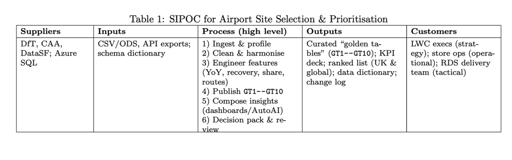

# Historical engineering evidence gallery — seven archive PNGs

This page accounts for all seven historical PNGs from `evidence-inbox/Data GitHub Project.zip`, in project order. **All seven exact original PNGs are included in this release package under the owner's explicit authorization; none are omitted.** One authentic, redacted Colab derivative is also included as a separate asset, not as a replacement for its original.

The archive sequence depicts the airport-selection process design, a historical Azure SQL resource, a Colab ETL/upload notebook, Azure SQL query output, a watsonx import, and two AutoAI experiment views. This is historical context, not a substitute for replayable source code, query text, exported Cognos/AutoAI models, or a deployment record.

## Original included in release candidate — SIPOC process design

The owner confirmed authorship and authorized publication. The diagram identifies CSV/ODS and API exports as inputs, six high-level stages from profiling through decision-pack review, GT1–GT10 and KPI/ranking outputs, and executive/operations/delivery audiences. It documents intended process design, not proof that each stage ran. See the [SIPOC technical notes](process/README.md) and [full historical technical notes](technical-notes.md), which map it to current Python/SQL code and clearly separate the historical drawing from the executable V2 pipeline.

## Per-image review

| Original archive PNG | Stage and work evidenced | Analytical / engineering detail visible | Publication status / specific boundary |
|---|---|---|---|
| `01-business-process-sipoc.png` | SIPOC for airport site selection and prioritisation | Original diagram defines CSV/ODS/API/schema inputs; ingest/profile, clean/harmonise, engineer features, publish GT1–GT10, compose dashboard/AutoAI insights, and review a decision pack; outputs include curated tables, KPIs, ranked lists, data dictionary, and change log. | **Original included in the release candidate** (`process/01-business-process-sipoc.png`): owner confirmed authorship and authorized publication. It is a design artifact, not proof every depicted stage ran. Detailed mapping is in [process technical notes](process/README.md). |
| `02-azure-sql-database.png` | Historical Azure SQL resource/database view | Shows the `golden_airports_db` target, Azure resource configuration and storage/monitoring context. It documents a historical environment, not a current service. | Exact original included as `azure/historical-azure-sql-database-original.png` at the owner's direction. Resource/account identifiers remain visible; no password or access token is transcribed separately. No Microsoft endorsement is claimed. |
| `03-colab-azure-etl.png` | Historical Colab upload notebook | Shows a SQLAlchemy/ODBC connection pattern, reading CSVs from `out/golden`, and writing generated tables to Azure SQL. The original result block includes historical counts; the separate redacted derivative masks it for comparison. The notebook source is absent, so this is not a replayable pipeline. | Exact original included as `colab/colab-etl-upload-original.png`; derivative `colab-etl-upload-redacted.png` is separately counted. No raw CSV is included; owner authorizes the screenshot. |
| `04-azure-sql-validation.png` | Historical Azure SQL query/result screen | Shows the GT1–GT10 object set and a populated GT10 recommendation grid with airport, passenger, route, recovery and score fields. It evidences a displayed query result, not independent validation: query text, source snapshot, run identity and reconciliation output are absent. | Exact original included as `azure/historical-azure-sql-validation-original.png` per owner direction. The screenshot is historical UI evidence; no current result or independent validation is claimed. |
| `05-watsonx-import.png` | Historical watsonx import workflow | Shows selection of ten Azure SQL/GT assets into the project. This is import-configuration evidence, not model training, scoring or validation. | Exact original included as `watsonx/historical-watsonx-import-original.png` per owner direction. Account/source labels and IBM UI are visible; no IBM endorsement is claimed. |
| `06-watsonx-autoai.png` | Historical AutoAI experiment overview | Shows a passenger-traffic prediction target, generated pipeline comparisons, and RMSE/MSE/R² metrics. Exact scores are not repeated here. | Exact original included as `watsonx/historical-watsonx-autoai-original.png`. No exported experiment, training code or independent holdout/validation artifact is present; displayed fit metrics do not establish generalisation or a business-ready forecast. |
| `10. Auto Ai experiment.png` | Historical AutoAI pipeline comparison | Shows a second/detailed pipeline-comparison view for the same project, including model ranking, error metrics and a passenger-traffic target. It records experimentation, not deployment or a business decision. | Exact original included as `watsonx/historical-watsonx-10-autoai-experiment-original.png` per owner direction. Experiment artifacts and reproducible evaluation are absent. |

### Historical Colab table-upload step

The visible code builds a SQLAlchemy connection using ODBC Driver 18 with encryption enabled and certificate trust disabled; credentials and server are variables/placeholders, not displayed values. It scans `out/golden`, reads each CSV with `pandas.read_csv`, and writes each table through `DataFrame.to_sql(..., if_exists='replace', index=False)`. The screenshot visibly confirms a successful connection, but the upload-result block is deliberately covered because it contained AVI0301-linked and mixed-source table counts.

Engineering interpretation: this is evidence of a local CSV-to-Azure-SQL handoff for downstream analytical tools. `if_exists='replace'` means a rerun replaces destination tables; the screenshot does not show transaction boundaries, staging/swap safety, schema contracts, row-level reconciliation, rollback or a retained run manifest. No filters, DAX measures, Cognos relationships, model scores or business finding are evidenced on this capture. The screen is not proof of a currently running Azure service or of the current V2 pipeline.

The redaction is an authentic derivative, not a reconstruction. Mechanically verified dimensions are `3278 × 1810`; all pixels outside the output-redaction rectangle match the archive original, the mask is opaque, and OCR on the derivative no longer recognizes upload-output lines. The source original and ZIP are preserved unchanged locally; the exact original PNG is also included in the gallery. Google brand use is shown only as historical project context and does not imply endorsement.

## Connection to the current project

The current Python/SQL V2 implementation is separately reviewable in [`src/airtraffic/`](../../../src/airtraffic/) and [`sql/`](../../../sql/). Its documented source contracts, deterministic transformations, candidate-grain definitions, reconciliation and quality gates belong to the current V2 system; they do **not** retroactively validate the historical Colab, Azure SQL or AutoAI screenshots. The current canonical test run and `sql/validation_queries.sql` are not claims that the historical result grid or AutoAI experiment was re-executed.

No live Azure SQL, Colab, Cognos or watsonx service was accessed or modified while preparing this gallery. No historical source dataset, notebook, SQL query export or AutoAI model package is included here. The actual portfolio decision supported by the reproducible current analysis is limited to prioritising a UK candidate for further commercial diligence; no historical screenshot establishes retail profitability, a deployed forecast or a production decision.

For the full 26-image accounting and the Power BI/Cognos galleries, see the [evidence index](../README.md). The [complete historical technical notes](technical-notes.md) cover all seven originals. Stage-specific documentation: [SIPOC](process/README.md), [Colab](colab/README.md), [Azure SQL](azure/README.md), and [watsonx](watsonx/README.md).