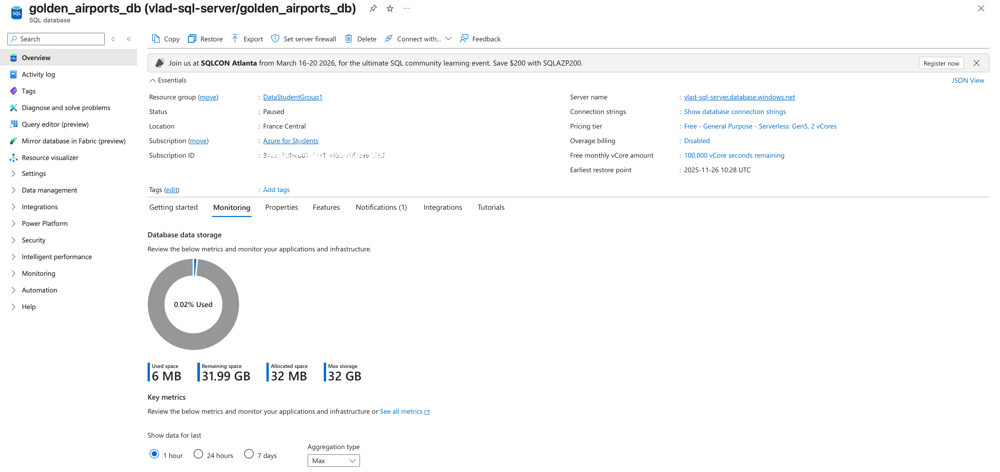
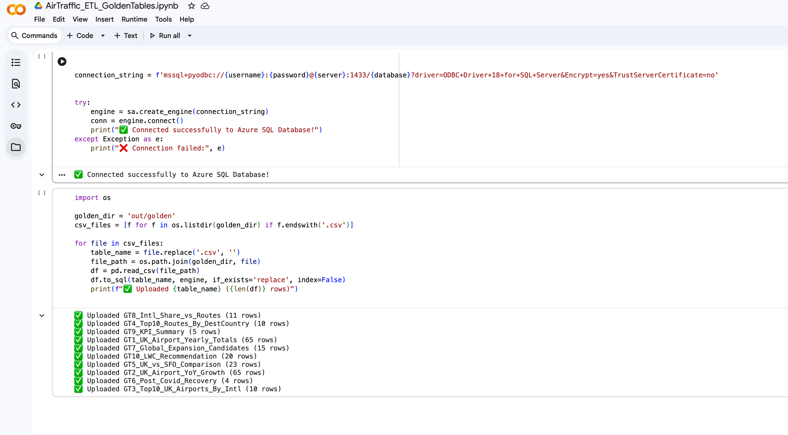
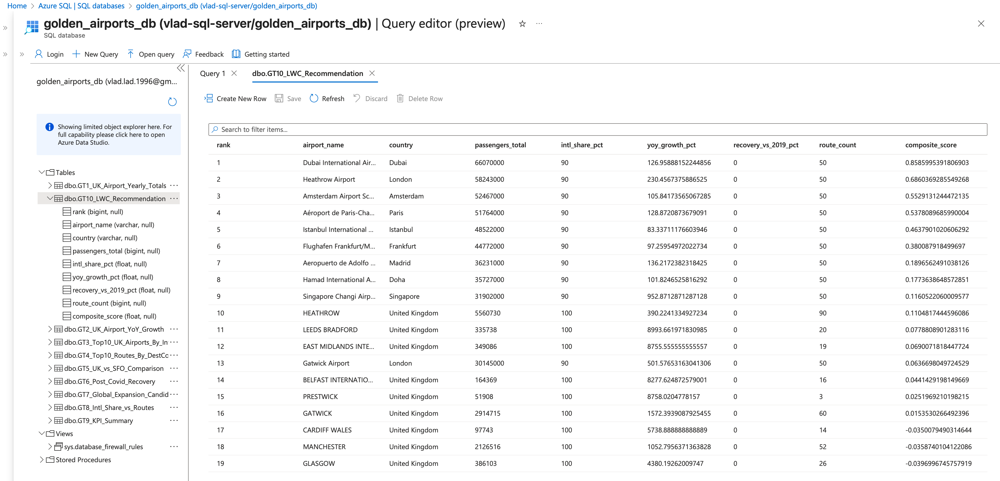
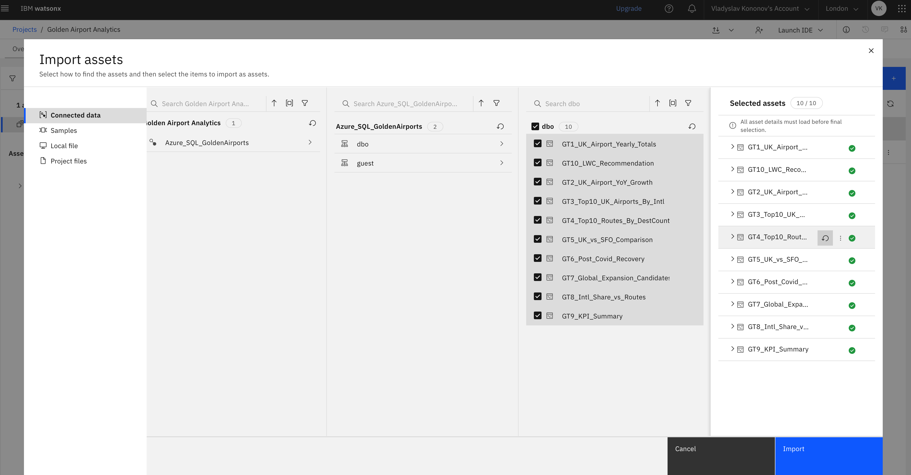
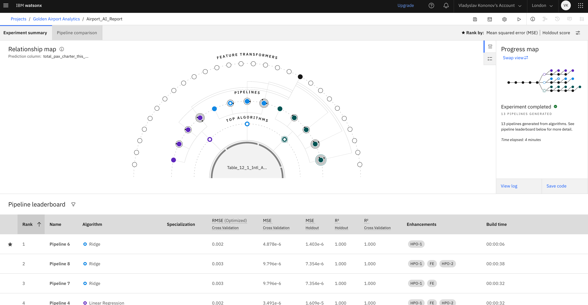
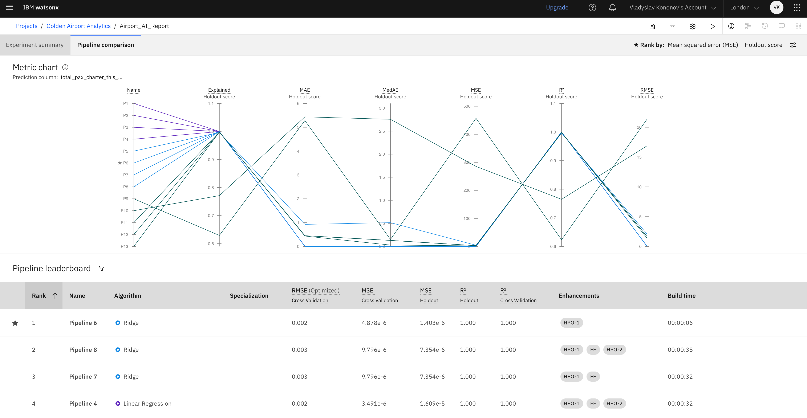

# Historical engineering evidence — seven original screenshots

These seven screenshots are shown in the archive’s project sequence. The owner states they created the screenshots and authorizes their publication. This is evidence of historical work, not proof of a current service, a reproducible run, vendor endorsement or independent validation. Visible product interfaces and any source-data conditions remain separate from the owner’s authorship statement.

The gallery contains **seven originals**: one SIPOC, two Azure SQL, one Colab and three watsonx/AutoAI images. The redacted Colab derivative below is a separate eighth asset; it does not replace or count as an original. Exact archive-byte verification is recorded in the evidence inventory.

## 1. SIPOC — process design

**Question illustrated:** what inputs, stages and outputs were intended for an airport-market decision process?

The owner-authored diagram connects source intake and profiling, cleaning, feature engineering, GT1–GT10 outputs, reporting/AutoAI exploration and decision-pack review. It documents process design and intended outputs; it does not prove every stage ran or that the pictured process is the later V2 implementation. The current crosswalk is in [SIPOC technical notes](process/README.md).

## 2. Azure SQL — historical database/resource view

**Question illustrated:** what historical database environment was used as the target for the notebook-based data handoff?

The screen shows a historical Azure SQL resource/database context, including the `golden_airports_db` target and visible resource/account labels. No password or access token is transcribed in this note. It is not evidence that the resource still exists or is currently secured, available or running. The later repository SQL design is separately reviewable in [`sql/schema.sql`](../../../sql/schema.sql), [`sql/views.sql`](../../../sql/views.sql) and the [Azure SQL notes](azure/README.md); no live Azure operation is claimed.

## 3. Google Colab — CSV-to-SQL ETL handoff

**Question illustrated:** how were prepared table files handed from a notebook workflow to Azure SQL?

The original capture shows a SQLAlchemy/ODBC connection pattern, iteration over CSV files from `out/golden`, `pandas.read_csv` and `DataFrame.to_sql(..., if_exists='replace')`. The displayed upload-result block contains historical output counts. This is screenshot evidence: the notebook source and original SQL queries are not in the repository, and the image does not show a quality gate, transaction-safe swap, full reconciliation or retained run manifest. `if_exists='replace'` replaces destination tables on rerun; it is not presented as the current recommended loading pattern. Current V2 ingestion and cleaning are in [`ingest.py`](../../../src/airtraffic/ingest.py) and [`clean.py`](../../../src/airtraffic/clean.py), not a reconstruction of the historical notebook.

### Separate redacted Colab derivative

This is a distinct derivative, not an original screenshot and not a substitute for the source above. Its output block is masked; the original remains unchanged and is shown immediately above. See the [Colab technical notes](colab/README.md) for the mechanical redaction check.

## 4. Azure SQL — historical validation/result screen

**Question illustrated:** what analytical objects and result grid were visible after the historical upload?

The screenshot displays a GT-named object set and a populated recommendation-style result grid. It records a query/result screen, but the query text, source snapshot, run identity and independent reconciliation are absent. It therefore does not establish that the results were correct or that the current V2 pipeline produced them. The current post-publication validation design is in [`sql/validation_queries.sql`](../../../sql/validation_queries.sql) and the [Azure SQL notes](azure/README.md); those files do not retroactively validate this historical image.

## 5. watsonx — data import workflow

**Question illustrated:** which prepared analytical assets were selected for the historical watsonx project?

The visible screen records selection/import configuration for GT-named assets. Import configuration is not evidence of model training, a validated prediction, or a deployed workflow. The screenshot includes IBM interface and project/source labels; no credentials are separately published here. No IBM endorsement is claimed. See the [watsonx notes](watsonx/README.md).

## 6. watsonx AutoAI — experiment overview

**Question illustrated:** what prediction experiment and generated pipeline comparisons were explored historically?

The screenshot shows a passenger-traffic target and AutoAI-generated pipeline evaluation fields. It establishes that an experiment view was captured; it does not provide the exported experiment, training dataset, split strategy, independent holdout evaluation or a reproducible model. Displayed fit metrics are not evidence of generalisation, business value or forecast reliability.

## 7. watsonx AutoAI — pipeline comparison

**Question illustrated:** how were candidate AutoAI pipelines compared within the historical experiment?

The image records a second comparison view with pipeline ranking and evaluation fields. It supports describing historical experimentation, not selecting a production model or claiming deployment. No model package or runnable experiment definition is present in the repository.

## Relationship to the current implementation

The documented project evolution is **SIPOC → local data acquisition/profiling → Colab/Python ETL → historical Azure SQL work → Cognos reporting and watsonx/AutoAI exploration → governed Python/SQL V2 → Power BI V2**. These are successive approaches to the business question; this is not an automated Cognos-to-Power-BI migration.

The current implementation is inspectable in [`src/airtraffic/`](../../../src/airtraffic/) and [`sql/`](../../../sql/). It has separate GT1–GT10 contracts, quality/reconciliation gates, scenario scoring and run provenance. It does not retroactively validate the historical notebook, Azure query grid or AutoAI experiment. No raw source CSV, credential, private cloud configuration, live service or AutoAI model export is included.

For the complete 26-item archive accounting—25 published originals and the local-only Dubai 07a item—see the [evidence index](../README.md), [Power BI gallery](../power-bi-v2/technical-notes.md) and [Cognos gallery](cognos/technical-notes.md). The seven-source archive’s detailed historical lineage notes remain in [technical notes](technical-notes.md).
