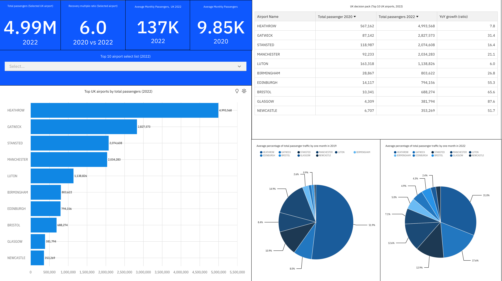
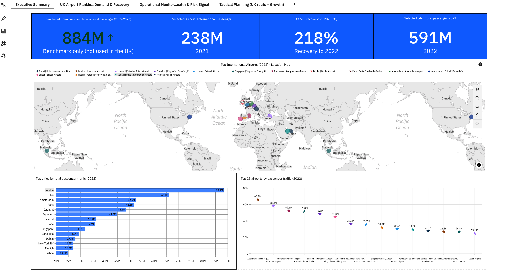
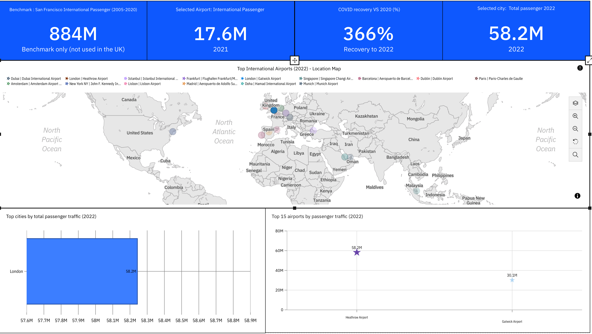
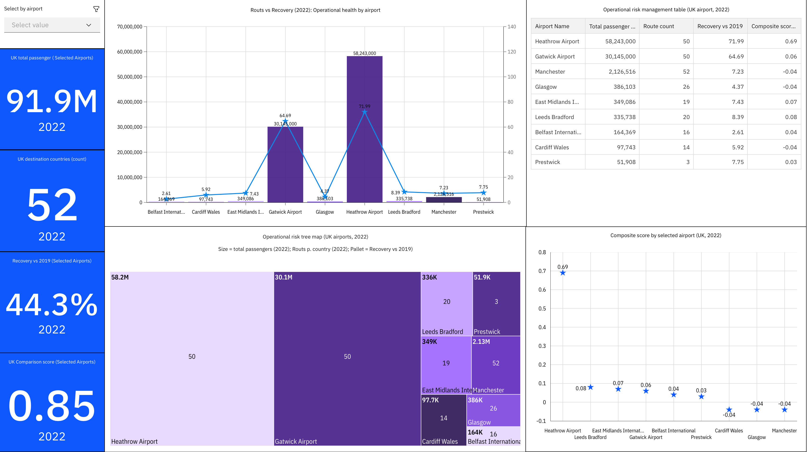
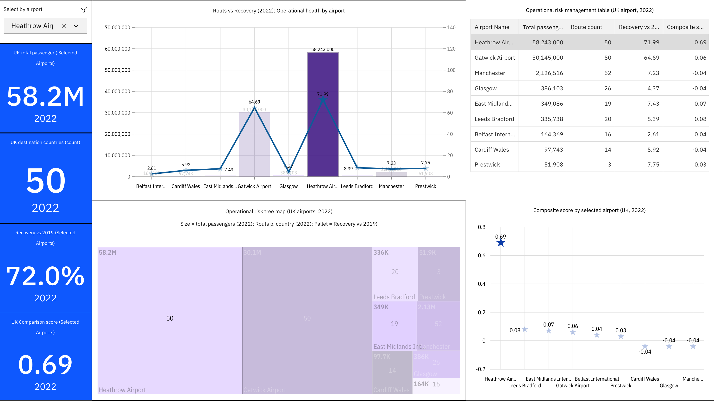
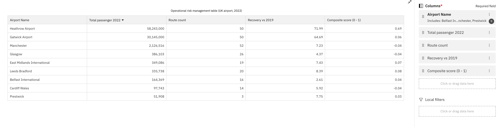

# Historical IBM Cognos — technical walkthrough of all eight original archive screenshots

All eight original Cognos PNGs are included in the gallery. The owner states they authored the reports, semantic model and analysis and has expressly authorized publication without restrictions; this is not an IBM endorsement or a claim of IBM permission. CAA attribution/no-sale conditions are retained on UK demand pages. No current Cognos deployment or report refresh is claimed.

The sequence follows the historical workflow: inspect the semantic model → review UK airport demand and recovery → explore executive and operational pages → inspect risk-ranking evidence.

## 1. Semantic model — historical data module

**Business purpose.** Provide a reusable analytical layer for the airport screening and reporting workflow rather than defining every report page against unstructured source extracts.

**What the screenshot evidences.** The visible Cognos data-module object list includes GT-named tables such as `GT1_UK_Airport_Yearly_Totals`, `GT2_UK_Airport_YoY_Growth`, `GT3_Top10_UK_Airports_By_Intl`, `GT4_Top10_Routes_By_DestCountry`, `GT6_Post_Covid_Recovery`, `GT8_Intl_Share_vs_Routes`, `GT9_KPI_Summary`, `GT7_Global_Expansion_Candidates`, and `GT10_LWC_Recommendation`. A Relationships area and diagram settings are also visible. This documents the historical BI model's object vocabulary and a relationship-design workspace.

**Model interpretation.** The later public V2 contract set defines GT1–GT10 grains and semantics, including one row per airport in GT1/GT3, airport × destination country in GT4, run × KPI in GT9, and candidate × scope × scenario × model version in GT10. These contracts provide current project documentation, but they do not prove that the historical Cognos module used exactly the same keys, joins, calculations, or final grain. The screenshot does not make individual cardinalities or filter directions legible enough to assert them.

**Decision supported.** A governed model structure can support consistent airport demand, destination, quality, and recommendation reporting. This image is evidence of model authoring context, not proof of model correctness or deployment.

**Validation and limits.** Current Python/SQL V2 documents reconciliation and quality gates and a recorded canonical run with 30 checks, zero failures, and zero warnings. That is not a validation of the historical Cognos module. No Cognos package, query definitions, or runnable source data are part of this public repository. IBM UI is visible; no IBM permission or endorsement is claimed.

## 2. UK demand filter — historical decision-pack view

**Business question.** How do the represented UK airports compare on passenger scale, and what does the selected airport's displayed period comparison suggest for the first-site screen?

**What the screenshot evidences.** The visible report is titled “UK decision pack (Top 10 UK airports, 2022)” and shows an airport list/filter with Heathrow selected. It includes total passengers, average monthly passengers, a top-airport ranking, and period-comparison/growth views. The capture visibly reports 4,993,568 for Heathrow in 2022, 567,162 in 2020, and a recovery multiple of 7.8; several other values/labels are small or OCR-ambiguous and are intentionally not transcribed here.

**Model and filters.** The report is an interactive Cognos page with a UK airport selection and top-10 presentation. The source inventory and local reconciliation associate its current/prior airport passenger pairs with UK CAA Table 12.1, comparison period 202205 and its supplied prior period (the screenshot labels 2022 versus 2020). The preserved GT1 output provides the same two-period airport comparison. This is a period comparison, not a continuous annual time series. The original Cognos query, field mapping, joins and refresh remain unavailable; other page calculations should not be inferred from the GT1 match.

**Interpretation and decision.** The page communicates Heathrow's leading displayed 2022 passenger total and a substantial historical recovery multiple, supporting further investigation of Heathrow in the historical decision pack. Recovery in airport passenger totals is not retail footfall, and the ratio is not a sales forecast.

**Validation and limitations.** No historical Cognos query, source-row extract, or independent Cognos recalculation is included. A separate local cross-check compared the ten displayed airport current/prior totals with the preserved GT1 output derived from CAA Table 12.1; all ten airport rows matched. This corroborates the source association but does not recover the original Cognos query or prove the report’s refresh path. The current V2 pipeline's recorded quality run does not validate this historical report. CAA attribution/no-resale conditions apply. IBM UI is visible; no IBM endorsement or separate permission letter is claimed.

## 3. UK demand recovery — historical two-period comparison

**Business question.** How do the ten represented UK airports compare on current and prior passenger totals, and how does the selected airport’s recovery ratio compare with its market position?

**What the screenshot shows.** The original report contains a UK airport selector and top-airport list, current/prior period passenger totals, average-monthly context, a recovery multiple, and monthly share views. It presents Heathrow selected and period context for 2020 and 2022. These are historical report values, not a forecast or retail-sales measure.

**Source and model cross-check.** A local comparison checked the ten displayed airport labels and all ten current/prior passenger pairs against `outputs/golden/GT1_UK_Airport_Period_Totals.csv`; all ten rows matched. That canonical GT1 output is derived from UK CAA Table 12.1, May 2022. This is strong source corroboration for the displayed table but not proof of the original Cognos query, ETL, relationship path, refresh or calculation implementation. Current V2 counterparts are [`golden.py`](../../../../src/airtraffic/golden.py), [GT1–GT2 contracts](../../../gt-contracts.md), and `sql/validation_queries.sql`; they are explanatory reference, not a retroactive Cognos test.

**Decision, validation and limits.** The page supports further UK-site diligence by showing passenger-market scale and a period comparison. It does not measure retail footfall, forecast sales, or prove profitability. CAA attribution and no-sale/no-resale conditions apply; the underlying CSV remains local. The original screenshot is included at the project owner’s direction. IBM Cognos UI is visible; no IBM endorsement or separate permission letter is claimed.

## Additional five original Cognos archive pages — complete gallery

The five additional originals are shown below with technical context. The owner authorizes publication; the descriptions avoid claiming that current Python/SQL code reproduces the historical Cognos query or scoring logic.

### 4. Executive summary — combined UK and global decision pack

The page brings together a UK airport ranking/demand view, a global airport ranking/map, an SFO historical benchmark, and a COVID-recovery panel. It is designed as a leadership overview for comparing market scale and recovery signals before drilling into airport detail. The dashboard layout suggests coordinated filters, but a PNG cannot verify which visuals cross-filter or what query/model relationships drive them.

The global airport ranking uses AVI0301/ICAO-linked values according to the project source inventory. The complete original is shown per the owner's direction; no cropped or reconstructed replacement is used. Current V2 mappings for UK totals, CAA/route measures and SFO context are in [`golden.py`](../../../../src/airtraffic/golden.py) and the [GT contracts](../../../gt-contracts.md); these do not establish the historic Cognos source joins or independently validate the displayed values.

### 5. Executive summary filter — selected-airport interaction

This second executive page captures a selected-airport state within the global executive dashboard. The selector changes the highlighted airport and the selected-city passenger KPI while the map and top-airport comparisons remain on the page. It demonstrates the intended interaction state, not the Cognos filter expression, join path, or runtime filter propagation.

The page contains AVI0301-linked global values and a global airport map. The original is included at the owner's direction; no numeric values are repeated in this note. The underlying model/data-module package and report specification are absent; the current V2 model is not offered as proof of the Cognos implementation.

### 6. Operational monitoring — multi-airport dashboard

This page combines an airport selector, KPI cards, a passenger-versus-recovery view, an operational-risk treemap, an airport comparison table, and a composite-score chart. Its intended operational question is which represented airport profiles warrant closer review across passenger scale, route breadth, recovery and a score field.

The report is labelled UK/2022, but the project source map associates the displayed operational values with AVI0301-matching benchmark metrics; the archive has no source query/model export to resolve that lineage. The original is included per the owner's explicit authorization. GT1, GT8, GT9 and GT10 in the current V2 contracts provide conceptual analogues for market, connectivity, quality and scoped candidate outputs only; they do not verify this historical screen's metrics or score formula.

### 7. Operational monitoring filter — selected airport

This image shows a selected-Heathrow state of the operational page. The selector narrows KPI cards, route/recovery visuals, treemap, comparison table and composite-score view to the selected airport while retaining the comparison context. This is filter-state evidence, not an exported Cognos filter definition or a test of relationship direction/cardinality.

Source lineage remains unresolved in the project archive and the local map associates these displayed benchmark metrics with AVI0301-linked values. No table row or metric value is repeated in this note. The original image is included per the owner's explicit authorization; it is not presented as a currently validated metric table.

### 8. Risk ranking — populated airport table and model fields

The table exposes airport name, total passenger measure, route count, recovery-versus-2019 field, and a displayed composite-score field. This is the most operationally actionable historical view: it makes the candidate attributes inspectable rather than showing only a single KPI. The screenshot does not disclose the composite-score weights, normalisation population, missing-value policy, scenario, version, or audit trail; these must not be inferred from the column label.

The source archive does not establish the table's historical lineage. The local evidence map notes that the UK-labelled values match AVI0301-linked metrics, but without source-to-field mapping this remains unresolved rather than a definitive source attribution. The original is included at the owner's direction; its numeric rows are visible only in the screenshot, not repeated in prose. The current GT10 contract is candidate × decision scope × scenario × model version; it is not assumed to be the same as this historical Cognos score.

## Crosswalk to current code, SQL and validation

The current analytical implementation is separately inspectable in [`golden.py`](../../../../src/airtraffic/golden.py), [`scoring.py`](../../../../src/airtraffic/scoring.py), [`quality.py`](../../../../src/airtraffic/quality.py), [`sql/schema.sql`](../../../../sql/schema.sql), [`sql/views.sql`](../../../../sql/views.sql), and [`sql/validation_queries.sql`](../../../../sql/validation_queries.sql). Current GT1–GT10 grains, source lineage and scenario semantics are defined in [GT contracts](../../../gt-contracts.md), [lineage](../../../lineage.md), and the [decision model](../../../decision-model.md). Tests of current behaviour are in [`test_golden_tables.py`](../../../../tests/test_golden_tables.py), [`test_scoring.py`](../../../../tests/test_scoring.py), [`test_quality.py`](../../../../tests/test_quality.py), and [`test_pipeline.py`](../../../../tests/test_pipeline.py).

No original Cognos data module, package, SQL/query export, refresh log or report specification is included. Therefore the current code, SQL, 45-test local run and 11-test public CI subset are evidence for the V2 implementation only; they do not validate the historical Cognos screenshots. All eight originals are included in the gallery at the owner's direction; source and calculation limitations remain explicit. The exact source ZIP and the [26-image inventory](../../README.md) are unchanged.