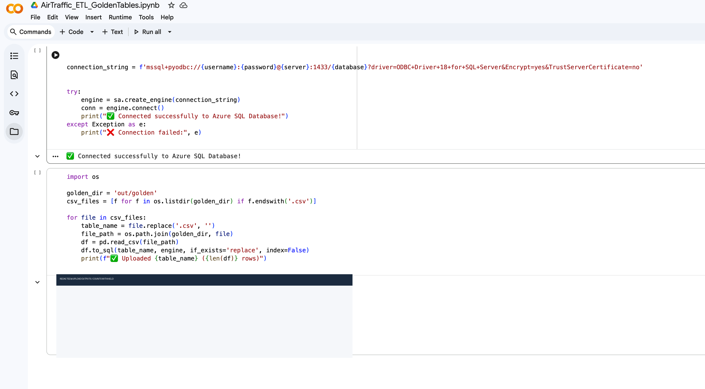

# Historical Google Colab evidence

This is an authentic, minimally redacted screenshot of the project notebook `AirTraffic_ETL_GoldenTables.ipynb`. It shows a SQLAlchemy connection using ODBC Driver 18 with encryption enabled and certificate trust disabled, a loop over CSVs in `out/golden`, `pandas.read_csv`, and `DataFrame.to_sql(..., if_exists='replace', index=False)`. The connection-success message is visible. The upload-result block is covered in full; no AVI0301-linked/mixed-source table counts or data values are reproduced. No actual credentials are visible: the connection code uses `{username}`, `{password}`, `{server}` and `{database}` placeholders.

The screenshot is historical evidence of a local CSV-to-Azure-SQL handoff, not a current pipeline, a reproducible notebook or proof of data reconciliation. In particular, `if_exists='replace'` overwrites destination tables on a rerun; the capture does not evidence transactional staging, rollback, schema contracts or source-to-target reconciliation. No measures, filtering, relationship logic or business finding are shown.

The unredacted original remains unchanged in `evidence-inbox/Data GitHub Project.zip` and is local-only because its output lines include AVI0301/GT7-derived counts whose redistribution rights are unresolved. The published derivative preserves all source pixels outside the opaque result-area mask; the masked region is marked visibly and OCR-checked. Google's [Brand Resource Center guidance](https://about.google/brand-resource-center/guidance/) permits Google brand elements solely for school projects; this page presents the capture only as the owner's academic project and does not imply Google endorsement or license the aviation data. The redaction is not a general screenshot permission.
