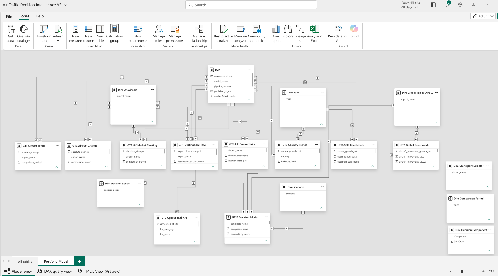
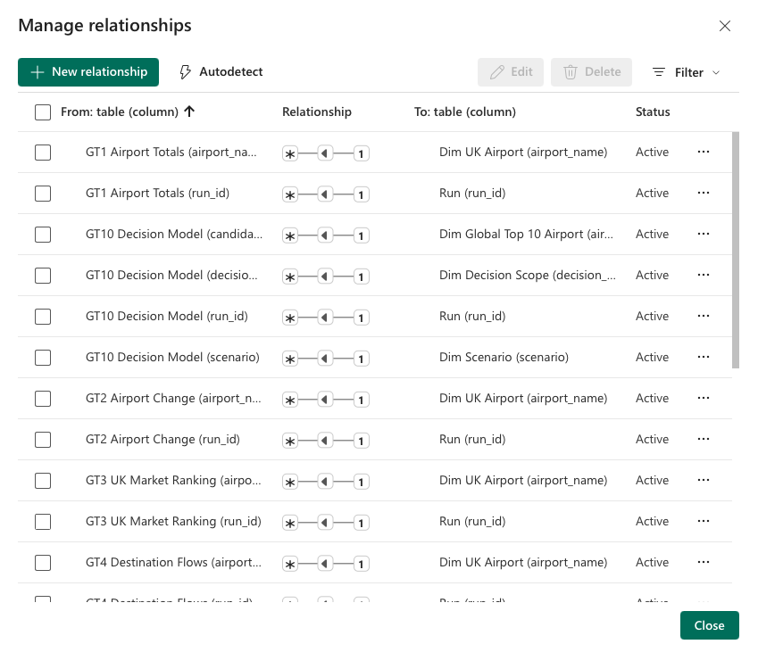
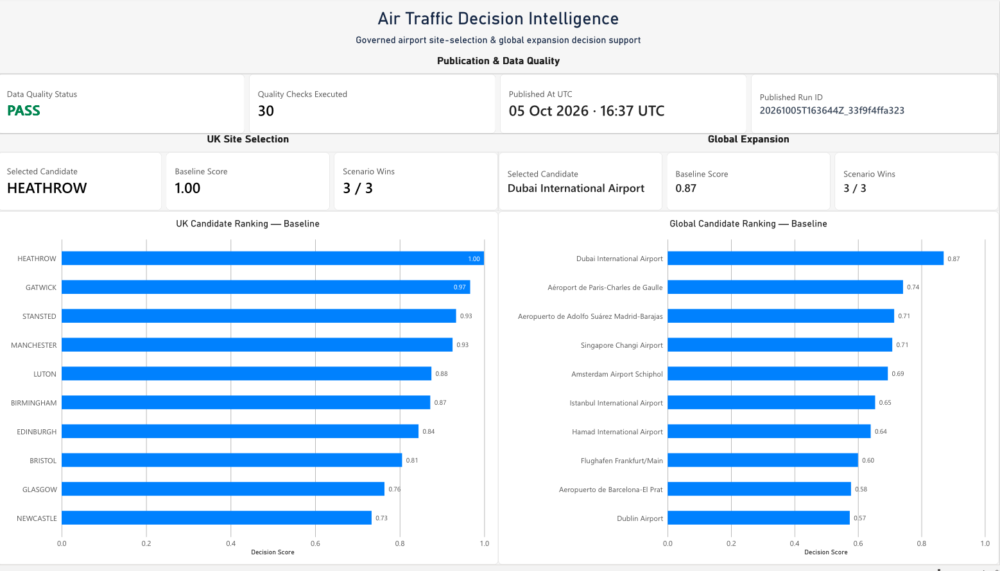
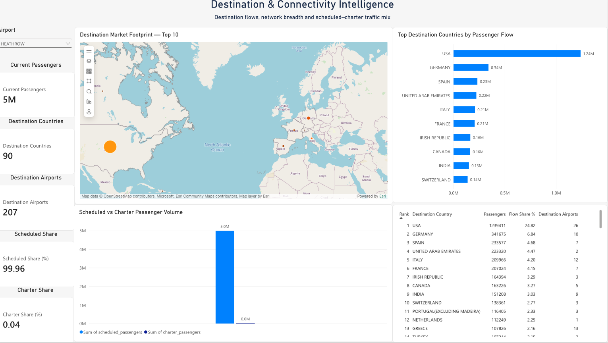
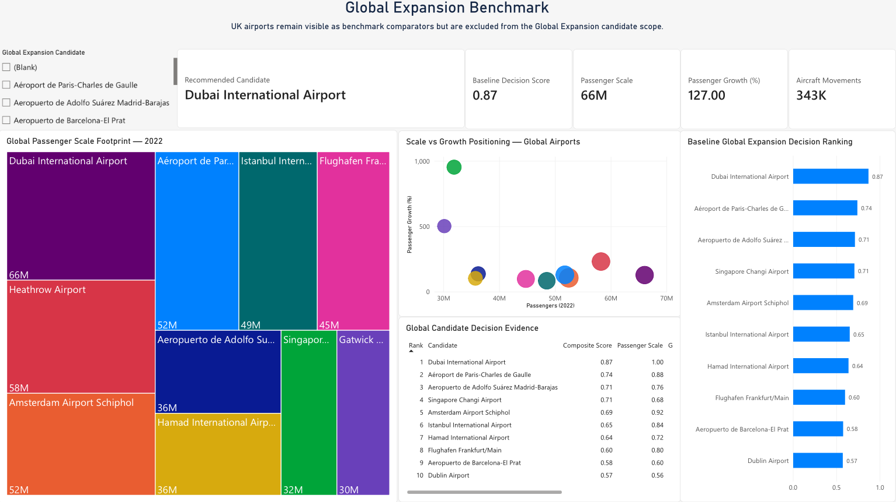
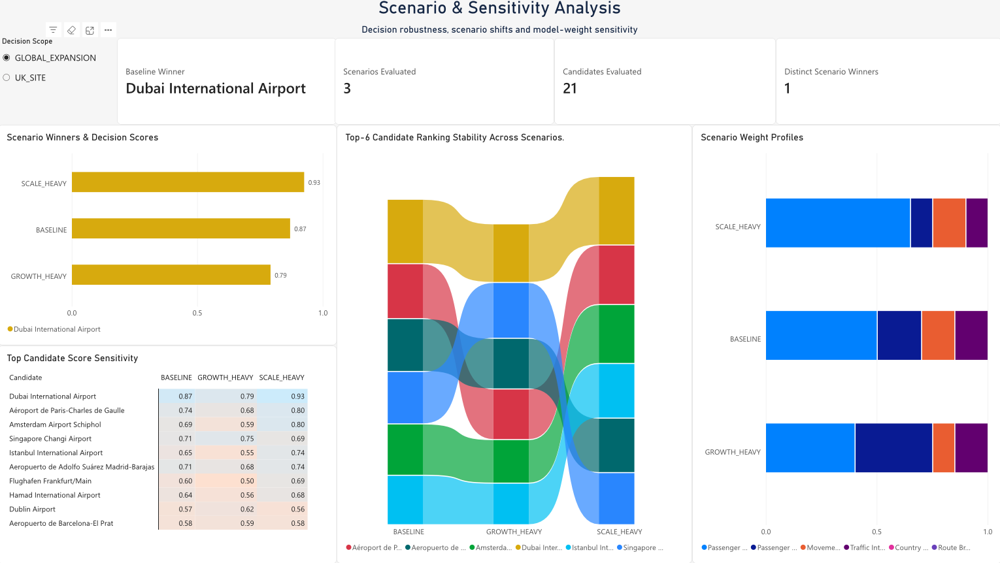
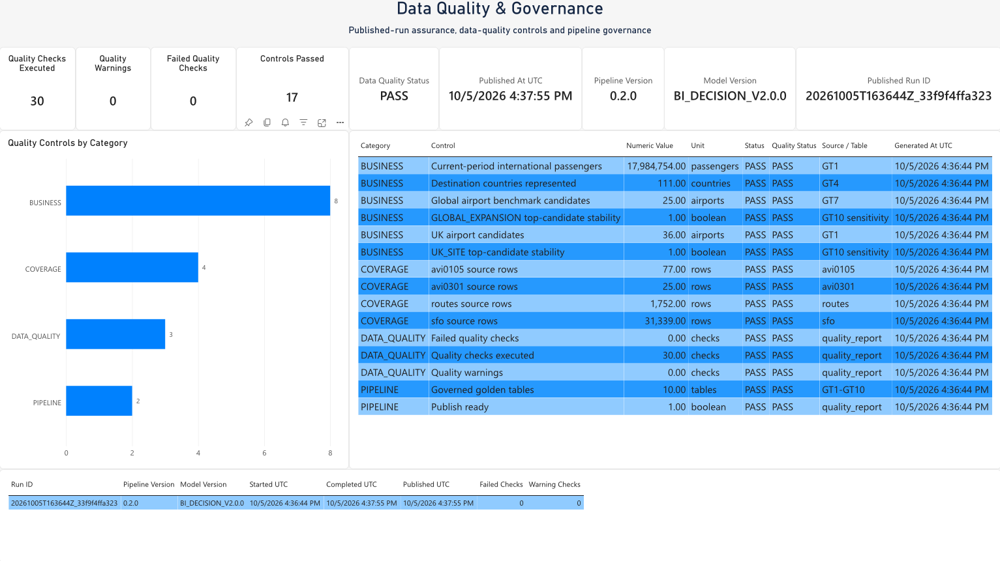

# Power BI V2 — technical walkthrough of all 11 original archive screenshots

The complete gallery contains all 11 original Power BI PNGs: nine report pages and two schema-only pages. The owner authorizes publication of the dashboard work and represents that it is cleared for this portfolio; this is not a Microsoft endorsement or a claim of bespoke Microsoft permission. CAA attribution/no-resale conditions are retained where applicable. No live Power BI service, refresh, PBIX, or deployment is claimed.

The sequence follows the decision workflow: inspect the UK market → test policy sensitivity → inspect the leading candidate → review model structure → compare global scope and governance.

## 1. UK market demand — scope and period comparison

**Business question.** Which represented UK airport has the strongest observed passenger market for the first UK_SITE boutique screen, and how does the selected market compare with its supplied prior period?

**Design and visible evidence.** The page presents a UK airport selector, current/prior passenger KPIs, airport ranking, market-share and traffic-share views, and a selected-airport comparison. The captured selection is Heathrow. Visible values include 4,993,568 current passengers, 567,162 prior-period passengers, 4,426,406 absolute difference, 27.77% represented-market share, rank 1, and 780.45% comparison-period change. These are the displayed source-period measures, not a forecast.

**Model and transformations.** The documented V2 concepts are GT1 (`passengers_current`, `passengers_prior`, `absolute_change`), GT2 (`growth_pct` and zero-baseline context), and GT3 (`market_share_pct`, `rank`). GT1 is one row per UK airport and reconciles to ROUTES; GT2 flags zero baselines and prevents extreme percentage changes from independently driving the strategic ranking; GT3 retains the complete represented airport population. The capture is historical report evidence: this description does not assert every displayed field was directly exported from the later V2 tables.

**Interpretation and decision.** Heathrow appears as the largest market in the represented CAA comparison population. The page supports prioritising it for further site diligence, not choosing a lease or predicting retail sales.

**Validation and limitations.** Current V2 documentation specifies source-specific cleaning, GT1–GT3 reconciliation, and publication quality gates. The recorded canonical local run reports 30 checks, zero failures, and zero warnings; it was not regenerated for this image. CAA Table 12.1, May 2022, requires attribution and prohibits resale. The source is a comparison snapshot, not a multi-year airport history. The 780.45% result is sensitive to the prior-period denominator. Retail footfall, available premises, rent, conversion, basket size, competition, and operating margin are absent. Power BI UI is visible; no Microsoft permission or endorsement is claimed.

## 2. UK_SITE scenario sensitivity — policy robustness

**Business question.** Does the preferred UK airport change when decision-makers express different priorities for passenger scale versus destination connectivity?

**Design and visible evidence.** The page displays a decision-scope control, baseline winner, scenario winner/score views, candidate sensitivity table, and ranking-stability visual. It reports three scenarios, 36 candidates, and one distinct scenario winner. Heathrow is shown as baseline winner and scores 1.00 in the visible baseline, connectivity-heavy, and volume-heavy columns. The candidate table makes comparisons inspectable rather than hiding them in a single KPI.

**Model and relationships.** The documented UK_SITE decision model uses the full represented ROUTES airport population and within-scope percentile components for passenger scale, destination-country breadth, and destination-airport breadth. Policy weights are explicit: BASELINE 0.50/0.30/0.20, VOLUME_HEAVY 0.65/0.20/0.15, and CONNECTIVITY_HEAVY 0.35/0.35/0.30. GT10 has grain candidate × decision scope × scenario × model version. Period growth is contextual and must not dominate the baseline. These contracts explain the documented decision framework; the screenshot alone does not prove a specific model refresh or implementation.

**Interpretation and decision.** The visible UK scenarios keep Heathrow at the top, suggesting robustness to these three tested policy-weight profiles. This is sensitivity to assumptions, not probability, statistical confidence, or commercial viability.

**Validation and limitations.** The project documents versioned weights, within-scope normalization, per-scenario ranking, and quality flags. The screenshot shows 36 candidates; no independent scoring rerun is evidenced here. CAA attribution/no-resale conditions apply. Only the documented policy profiles were tested; changed source coverage or different priorities may alter results. Retail economics are absent. Power BI UI is visible; no Microsoft permission or endorsement is claimed.

## 3. Heathrow candidate detail — evidence behind the screen

**Business question.** What observed market and network evidence supports Heathrow's UK_SITE rank, and does its recommendation tier remain stable across tested policies?

**Design and visible evidence.** The capture identifies Heathrow, scope `UK_SITE`, displayed data-quality flag `PASS`, baseline rank 1, and tier `PRIMARY`. It shows candidate sensitivity across BASELINE, CONNECTIVITY_HEAVY, and VOLUME_HEAVY, a component-profile view, and underlying candidate evidence. Visible measures include 4,993,568 passengers, 780.45% growth context, 90 destination countries, and 207 destination airports. The displayed model label is `BI_DECISION_V2.0.0`.

**Model and metric lineage.** Documented contracts map passenger totals/change to GT1–GT2, airport rank to GT3, and distinct destination-country/airport counts to GT8. GT10 stores a scope-specific recommendation with component scores, rank, tier, quality flag, scenario, and model version. UK_SITE baseline weights emphasize passenger scale (0.50), country breadth (0.30), and route breadth (0.20); sensitivity profiles reweight those priorities. `PRIMARY` means rank 1 within scope, not a probability of success.

**Interpretation and decision.** The page supports carrying Heathrow forward to commercial and operational diligence. The extreme percentage change is contextual and should not be read as expected growth.

**Validation and limitations.** The screenshot's `PASS` is a displayed candidate status, not evidence of a new validation run. The separately documented canonical local run reports 30 checks with no failures or warnings. CAA Table 12.1 attribution/no-resale conditions apply. The capture does not establish retail footfall, premises availability, costs, competition, or profitability. Power BI UI is visible; no Microsoft permission or endorsement is claimed.

## 4. Semantic model overview — analytical objects

This unchanged, schema-only screenshot documents the semantic-model layer. The project describes GT1–GT10 as a governed interface between transformation, SQL, and BI consumers: UK market totals/change/ranking, destination flows/connectivity, operational quality, and scenario-versioned recommendations.

The exact screenshot bytes are taken directly from the supplied ZIP and verified against the archive entry with SHA-256. It documents model objects, not a machine-readable model, refresh, source lineage, measure correctness, row-level security, or deployed service. Grain and metric definitions are in [GT1–GT10 contracts](../../gt-contracts.md) and the [decision model](../../decision-model.md).

## 5. Relationships overview — model navigation

This unchanged, schema-only screenshot records the model relationship view. Relationships govern how report filters reach model objects; the image is design evidence, not a machine-readable model definition or relationship test.

No source rows are shown. The exact image bytes were extracted from the supplied archive and verified with SHA-256. The screenshot alone does not establish every key, cardinality, filter direction, ambiguity, or runtime behavior. The actual model artifact is not included here, so those details are not independently reviewable from this gallery.

## 6–11. Additional original Power BI pages — complete archive gallery

The six additional archive originals are included below under the owner's explicit authorization. Their technical notes distinguish displayed historical evidence from current V2 code and reproducible results. Raw CSVs are not included.

### 6. Executive decision summary — two decision scopes

The screenshot lays out a leadership view with publication/quality status, a UK_SITE candidate summary and a separate GLOBAL_EXPANSION candidate ranking. It visibly connects run status, scenario stability and candidate detail to a decision-pack page. The global panel contains AVI0301/ICAO-derived names, ranks and score results, so no result values or candidate list are repeated here.

The intended model correspondence is GT1–GT3 for UK demand/rank, GT7 for the global benchmark, and GT10 for scope- and scenario-versioned decisions; GT9/quality outputs explain run and coverage status. Current code analogues are [`golden.py`](../../../src/airtraffic/golden.py), [`scoring.py`](../../../src/airtraffic/scoring.py), and [`quality.py`](../../../src/airtraffic/quality.py), with contracts in [`gt-contracts.md`](../../gt-contracts.md). Those are the current V2 implementation, not proof of the historical screenshot's exact measures. The visible run label is historical display evidence; its status is not an independent validation. The original is included per the owner's explicit authorization; no current global recommendation is inferred from it.

### 7. Destination connectivity — map and network footprint

This report page combines airport selection, passenger scale, country and airport breadth, scheduled/charter composition, destination-country flows and a map. Its analytical question is whether passenger scale is accompanied by route breadth; the map adds geographic orientation but does not establish commercial site suitability.

The project’s current contract maps airport–destination-country flows to GT4 and destination breadth/composition to GT8; the related Python transformation is in [`golden.py`](../../../src/airtraffic/golden.py), and the CAA snapshot/conditions are in [data-source licensing](../../data-sources-and-licensing.md). The original screenshot includes visible OpenStreetMap, Microsoft, Esri Community Maps and Esri map credits. It is included unchanged at the owner's direction; the credits are retained, and this does not imply endorsement by Microsoft or the map providers.

### 8. Global expansion benchmark — candidate screening

The page presents a global passenger-scale comparison, a scale-versus-growth visual, a candidate list, and a baseline ranking. The visible UI differentiates the GLOBAL_EXPANSION population from UK comparator airports, which is an important modelling boundary: a comparator is not automatically eligible as a global candidate.

The historical screenshot’s global benchmark is tied to AVI0301/ICAO-derived inputs. The current model keeps GT7/global features separate from CAA-based UK measures and scores GLOBAL_EXPANSION independently in [`scoring.py`](../../../src/airtraffic/scoring.py). The screenshot is included under the owner's latest representation that publication is cleared; raw source rows remain excluded. It is historical portfolio evidence, not a validated or current global recommendation.

### 9. Global sensitivity — policy-weight robustness

This capture shows a scope control and three global scenario profiles (baseline, scale-heavy, growth-heavy), together with candidate-score sensitivity and ranking-stability views. Its design asks whether a global recommendation changes when the policy trade-off between scale and growth changes. These are deterministic weight-profile comparisons, not probabilities or confidence intervals.

The current GT10 contract stores candidate × scope × scenario × model-version decisions and keeps scope-specific candidate populations separate. The current implementation and explicit weight configuration are in [`scoring.py`](../../../src/airtraffic/scoring.py) and [`decision-model.md`](../../decision-model.md). The original is included under the owner's authorization; its historical candidate population and scores are not treated as a current reproducible result.

### 10. Data quality and governance — publication gate

The page combines quality-check categories, source-coverage controls, publication status and run/version context. It appears intended to answer whether a decision page should be consumed and what controls were applied. The original displays per-source coverage values and global-candidate stability controls; this note does not retype those data-bearing values or claim they were independently validated.

The current V2 equivalents are `quality.py`, the pipeline’s `assert_publishable()` gate, the GT9/run metadata contract, and the public-safe validation summary. Reconciliation and validation SQL are in [`sql/validation_queries.sql`](../../../sql/validation_queries.sql); current tests are in `tests/test_quality.py` and `tests/test_pipeline.py`. These current artifacts do not retroactively validate the Power BI screenshot or prove its displayed report refreshed from that run. The original is included per the owner's explicit authorization; no raw source CSV or independent Microsoft endorsement is claimed.

### 11. Dubai candidate detail — global model output

The page drills into one global candidate with scope, baseline rank/tier, data-quality status, scenario sensitivity, component profile and underlying evidence. Its purpose is explainability: expose why the candidate ranks where it does and which model dimensions contribute, rather than presenting a recommendation as a black-box KPI.

The current decision-model vocabulary includes scale, growth, movement, traffic intensity and connectivity features; [`scoring.py`](../../../src/airtraffic/scoring.py), [`gt-contracts.md`](../../gt-contracts.md), and [`tests/test_scoring.py`](../../../tests/test_scoring.py) describe the current implementation/test boundary, not the exact historic report calculations. The owner authorizes the original screenshot's publication; this page is not a claim that its historic score has been re-run or independently validated.

## Shared evidence and validation boundary

All 11 Power BI images are genuine original archive captures; no dashboard was reconstructed. The repository does not include the Power BI project/model file or the historical report query definitions, so DAX measures, relationship cardinality/filter direction, refresh mode, and visual-to-source lineage cannot be independently asserted from the PNGs. The source-dependent local test suite covers the current Python implementation, while the 11-test CI subset is source-free; neither validates these historical screenshots. CAA attribution/no-resale terms are retained where relevant. Publication of the owner's work follows the owner's latest explicit authorization; no Microsoft endorsement or bespoke vendor permission is claimed.